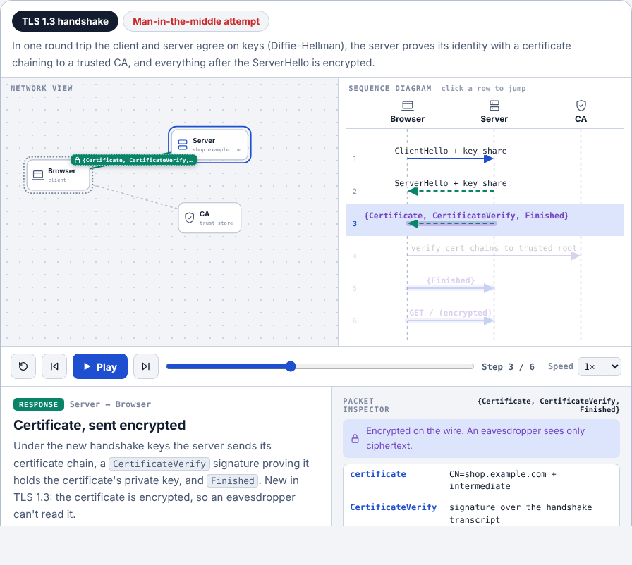

# Handshake Field Guide

An interactive field guide to **24 authentication and authorization methods**: passwords, HTTP Basic, sessions, API keys, JWT, OAuth 2.0, OpenID Connect, TLS, mTLS, SSH, SSO, SAML, Kerberos, LDAP, RADIUS, MFA, TOTP, passkeys (WebAuthn), magic links, HMAC signing, RBAC/ABAC/ReBAC, OAuth scopes and OPA.



Every topic goes from basics to deep detail and includes:

- **An animated packet-flow diagram.** Watch requests, responses and encrypted traffic move between nodes, with a synced sequence diagram, a packet inspector and play/step/speed controls.
- **Attack mode.** Each diagram replays the flow under attack and shows the defence that stops it.
- **Hands-on playgrounds** that use real browser crypto: decode and verify a JWT, generate live TOTP codes, sign with a private key, watch one byte break an HMAC, and see why a passkey can't be phished.
- **Step by step.** Near the top of every topic: the whole method as a numbered list of who does what — setup steps first, then what happens on every login or request — with a note on what is often explained wrong. A reference page, **All step-by-steps**, puts all 24 lists on one page for quick revision.
- **How it works inside.** Written in short, simple sentences: what the keys, tokens and hashes really look like, which file or table each piece lives in, and the exact steps or math the machines run (for example how `ssh-keygen` makes an Ed25519 key and how the server checks the signature).
- **A solved example.** One worked problem per topic with real numbers: toy RSA for SSH, Diffie–Hellman for TLS, the RFC 6238 TOTP vector, a hand-built JWT, PKCE, a RADIUS password, a webhook HMAC and more. The solution is hidden until you open it, so you can try first.
- **Architecture, real-world uses, how to use it, pros and cons, history, and hidden gotchas.**
- **Interview prep.** A 30-second "explain it" answer, model answers tagged junior/mid/senior, and a quiz.

There are also reference pages: all step-by-steps on one page, a comparison table, a "which method should I use?" helper, an interview question bank, and a glossary.

It's a plain static site: no build step, no framework, no backend.

---

## Host it on GitHub Pages (free)

You need a free [GitHub account](https://github.com/signup). On the Free plan the repository must be **public** for Pages to work.

### Option A: in the browser (no Git needed)

1. **Unzip** the download. You'll get a `handshake-field-guide` folder.
2. On GitHub, click **+** (top right) → **New repository**.
   - Name it `handshake-field-guide`.
   - Set it to **Public**.
   - **Don't** tick "Add a README" (you already have one).
   - Click **Create repository**.
3. On the new empty repo page, click **uploading an existing file**.
4. Open the unzipped folder, select **everything inside it**, and drag it onto the page.
   - Hidden files (`.nojekyll`, `.github`) may not show in your file manager. The site works without them, but on macOS press <kbd>Cmd</kbd>+<kbd>Shift</kbd>+<kbd>.</kbd> to show them, and on Windows enable *View → Hidden items*.
   - Skip the `node_modules` folder if it exists.
5. Click **Commit changes**.
6. Go to **Settings → Pages** (left sidebar). Under **Build and deployment**:
   - **Source:** *Deploy from a branch*
   - **Branch:** `main`, folder **`/ (root)`**, then **Save**.
7. Wait 1–2 minutes and refresh the Pages settings. Your link appears at the top:

   ```
   https://<your-username>.github.io/handshake-field-guide/
   ```

### Option B: with Git on the command line

The zip already contains a Git repository with one commit, so you only need to point it at GitHub and push:

```bash
cd handshake-field-guide

# 1. Create an EMPTY public repo named handshake-field-guide on github.com first, then:
git remote add origin https://github.com/<your-username>/handshake-field-guide.git
git branch -M main
git push -u origin main
```

Then do step 6 above (**Settings → Pages → Deploy from a branch → `main` / root → Save**).

If GitHub asks for a password when you push, use a [personal access token](https://github.com/settings/tokens) or sign in with [GitHub CLI](https://cli.github.com/) (`gh auth login`). Your account password won't work.

### Updating the site later

Edit files, then commit and push (or upload the changed files in the browser). Pages redeploys automatically within a minute or two. To check progress, open the **Actions** tab and watch the "pages build and deployment" run.

### Optional extras

- **Shorter URL.** Name the repo `<your-username>.github.io` and the site is served at `https://<your-username>.github.io/`.
- **Custom domain.** In **Settings → Pages → Custom domain**, enter your domain, then add the DNS records GitHub shows. See [GitHub's custom-domain guide](https://docs.github.com/en/pages/configuring-a-custom-domain-for-your-github-pages-site).
- **Link to one topic.** Every topic has its own address, e.g. `…/handshake-field-guide/#jwt` or `#webauthn`.

---

## Run it locally

Any of these work:

```bash
npm start                    # uses Node 18+, no install needed → http://localhost:8080
python3 -m http.server 8080  # if you have Python instead
```

You can also double-click `index.html`. It works straight from disk, but a local server is closer to how GitHub Pages behaves.

## Run the tests

The test loads every topic in a simulated browser. It checks every diagram, playground, quiz and reference page, all cross-links and quiz answer keys, and it verifies the TOTP generator against the official RFC 6238 test vectors. It also recomputes the numbers in the solved examples (hashes, HMACs, RSA and Diffie–Hellman results) and fails if any value on the page is wrong.

```bash
npm install
npm test
```

The workflow in `.github/workflows/test.yml` runs the same test on GitHub for every push. Results appear in the **Actions** tab.

---

## Project structure

```
index.html                 page shell: header, sidebar, main area
assets/css/styles.css      all styles (light + dark themes via CSS variables)
assets/js/engine.js        registry (window.HS) + the packet-flow player
assets/js/tools.js         the interactive playgrounds
assets/js/topics/*.js      topic content, one file per group
assets/js/topics/t-extra.js  architecture, real-world uses and interview summaries
assets/js/topics/t-inside-*.js  "How it works inside" + "Solved example" for every topic
assets/js/topics/t-steps.js  "Step by step" lists + the All step-by-steps page
assets/js/reference.js     home, compare, "which should I use?", interview bank, glossary
assets/js/app.js           router, sidebar, search, quizzes, progress
tests/render.test.js       automated render test (npm test)
tests/serve.js             tiny local server (npm start)
.nojekyll                  tells GitHub Pages to serve files as-is
```

Scripts load in order from `index.html`. The engine creates `window.HS`, each topic file registers into it with `HS.add({...})`, and `app.js` renders whichever page is in the URL hash.

### Adding a topic

Copy any `HS.add({...})` block in `assets/js/topics/`, give it a new `id` and `group` (`start`, `core`, `ent`, `modern` or `authz`), and fill in the fields. The diagram is defined by `flow.nodes` (positions on a 640×300 canvas) and `flow.normal.steps` / `flow.attack.steps`, where each step has a from-node `f`, a to-node `t`, a kind `k` (`req`, `res`, `int` or `atk`), a label `l`, a description `d` and inspector `data`. Also add an `inside` list (`[heading, html]` pairs) and an `example` object (`title`, `problem`, `steps`, `answer`) — see `t-inside-1.js` for the shape. Run `npm test` afterwards; it catches broken node references, missing playgrounds and bad quiz keys, and topics missing these two sections.

---

## Notes

- Progress (opened topics and passed quizzes) is saved in your own browser's local storage only.
- Fonts load from Google Fonts and code highlighting from cdnjs. If either is blocked, the site falls back to system fonts and plain code blocks.
- There's no license file yet. If you want others to reuse the code, add one; GitHub offers a picker under **Add file → Create new file → `LICENSE`**.
